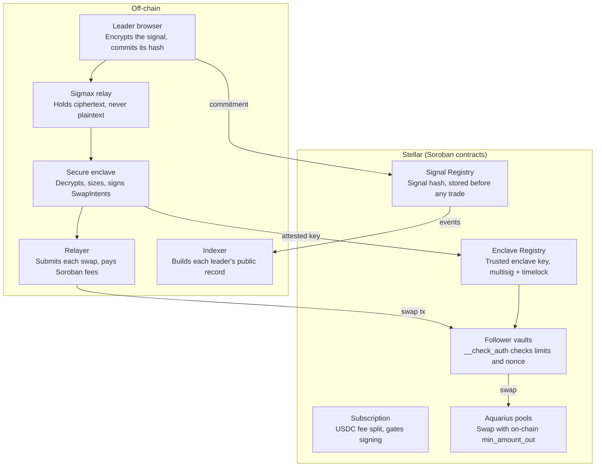

# Sigmax on Stellar: Technical Architecture

Abdelrahman Ahmed · November 2026 · SCF #46 Build Award submission

> **Status: planned work.** Nothing in this document is deployed on Stellar yet. There is no Stellar
> code in this repo, no Testnet deployment and no users. Everything below describes what the SCF #46
> award will build. The Story and Flare code elsewhere in this repo are earlier prototypes, kept as
> history (see [Prototype history](#prototype-history-and-what-carries-over)).

Related: [Stellar integrations](integrations.md) ·
[ADR 0001: smart-account vaults and Aquarius first](adr/0001-smart-account-vaults-and-aquarius-first.md)

## Overview

Sigmax brings confidential copy trading to Stellar. A leader's trade signal stays encrypted from their browser to a secure enclave, and every follower's trade executes from the follower's own Soroban smart-account vault, inside limits the follower sets.

This SCF #46 submission funds a rebuild of Sigmax on Stellar in three tranches over about four and a half months: an MVP on Testnet, a Testnet release with a hardware-attested enclave, and a guarded Mainnet launch.

**Why it matters.** In copy trading today, proving a track record means publishing entries, exits and sizes. Anyone who sees a signal can copy it or trade ahead of it, and followers fill late because signals are executed one account at a time. Sigmax keeps the strategy private, keeps funds in the follower's custody, and leaves a public on-chain record that anyone can audit.

**What is new on Stellar.** Earlier Sigmax prototypes ran on Story (4th place, Story CDR Buildathon 2026) and Flare, with execution on Hyperliquid testnet through a bridge. Those chains have no native trading venue, so execution happened off-chain. On Stellar, custody, policy enforcement, execution and the performance record will all live on the same chain, and settlement is final in about 5 seconds.

## System architecture

Four off-chain services will handle the private part of the flow. Every rule that protects funds will be enforced by Soroban contracts on Stellar.



The enclave is the only component that sees plaintext. The relayer and relay are untrusted: they move ciphertext and signed intents, and every vault re-checks each intent on-chain.

## Follower vault (Soroban smart account)

Each follower will get their own vault: a Soroban custom account (C-address) that holds their assets and implements `__check_auth`. The vault will have two signers with different powers.

| Signer | Key type | Can do |
| --- | --- | --- |
| Owner (follower) | ed25519 or passkey (secp256r1), via their wallet | Deposit, withdraw, change limits, pause, unfollow |
| Enclave key | ed25519, registered in the Enclave Registry contract | Authorize one swap that fits every limit below. Nothing else |

**Policy stored in the vault, set by the owner:**

- Allowed assets (allowlist of SAC token contracts)
- Allowed venues (allowlist of router/pool contract IDs)
- Maximum size per trade, as an absolute amount and as a share of vault balance
- Maximum number of trades and total volume per rolling 24 hours
- Followed leader ID and an expiry date for the whole delegation
- Pause flag

**The swap authorization the enclave signs:**

```
SwapIntent {
  vault, leader_id, signal_commitment,
  venue, asset_in, asset_out,
  amount_in, min_amount_out,
  nonce, expires_at_ledger
}
```

**What `__check_auth` checks when the enclave key signs:**

1. The signature is valid and the key is the current key in the Enclave Registry.
2. The nonce is unused, and the current ledger is before `expires_at_ledger`.
3. Assets, venue and amounts fit the stored policy and the rolling 24-hour limits.
4. The signal commitment exists in the Signal Registry, so every trade ties to a signal published before execution.
5. The authorization contexts match the intent exactly. The vault walks the full context tree (vault → router or pool → token `transfer`) and rejects any context that is not the expected swap call with the expected arguments. A signed intent cannot be reused to authorize a transfer to any other address.

`min_amount_out` is passed to the pool call (the `out_min` argument of the Aquarius `swap` function), so the swap reverts on-chain if the price moved past the follower's slippage limit. Withdrawals, policy changes and signer changes require the owner signature only. The enclave key can never move funds out of the vault except through an approved swap, and swap output always returns to the vault.

We will build on the [OpenZeppelin Stellar smart-account and policy contracts](https://docs.openzeppelin.com/stellar-contracts/accounts/smart-account) where they fit, rather than writing auth from scratch. Their model (signers, context rules, policies) maps onto the two signers above. The swap check itself will be a Sigmax policy that reads the call arguments of each context, because a threshold policy that does not inspect the context would grant the enclave key every function of an allowlisted contract. We will pin an audited release of the library and track its security advisories.

## Signal lifecycle

A signal will travel from the leader's screen to every follower's swap in seven steps, and the plaintext will exist only in the leader's browser and inside the enclave.

1. **Write.** The leader enters pair, side, size, entry, take profit and stop loss in the Sigmax web app.
2. **Seal.** The browser encrypts the signal with ECIES to the enclave's attested public key. It also computes `commitment = hash(signal, salt)`.
3. **Commit.** The leader's wallet signs a call to the Signal Registry contract that stores the commitment, the leader ID and a timestamp. The ciphertext goes to the Sigmax relay. Neither reveals the trade.
4. **Decrypt and size.** The enclave decrypts the signal and checks the commitment. For each follower vault it reads balance and policy from Stellar RPC, computes a trade size that fits the follower's limits, and gets a quote from the venue.
5. **Authorize.** The enclave signs one `SwapIntent` per vault, with `min_amount_out` set from the quote and the follower's slippage limit.
6. **Execute.** The relayer submits each swap transaction and pays the fees. Each vault's `__check_auth` verifies the intent and the pool enforces `min_amount_out`. A failing check reverts only that follower's trade.
7. **Record.** Swap events and the signal commitment are indexed into a public leader record. After the position closes, the leader can reveal the signal and salt so anyone can verify that the commitment matched the trades.

**Fan-out.** Steps 5 and 6 run in parallel across vaults, because each vault is a separate account with its own authorization. The goal is to fill all followers within a few ledgers of each other, instead of one account at a time. The relayer will submit from a pool of channel accounts, so swaps for different vaults do not queue behind one source account's sequence number.

## Execution venues

Phase 1 will execute on Soroban liquidity, Aquarius pools first, because a C-address vault can authorize Soroban contract calls but cannot submit classic Stellar DEX operations.

| Phase | Venue | How the vault reaches it | Status in this plan |
| --- | --- | --- | --- |
| 1 (Tranche 1) | Aquarius AMM pools (constant-product and stable) | Direct pool `swap` call, or through the Soroswap aggregator restricted to Soroban AMM routes. Assets move as SAC tokens | Committed |
| 2 (Tranche 2 spike) | Stellar DEX order book (SDEX) | Only through a path that keeps every vault limit enforced and funds under vault control | Feasibility spike with a written report. Built in Tranche 3 only if the spike passes |
| Later | Other venues | Same `SwapIntent` model | Out of scope for this award |

**Router allowlist.** The vault only accepts venue contracts in its allowlist, so a router or pool upgrade cannot widen what the enclave can do. Aggregator routes containing any leg outside the allowlist are rejected by `__check_auth`. The Soroswap aggregator can also route through SDEX, so Sigmax will restrict it to Soroban AMM protocols when requesting a route, and the vault will reject any route argument that names another protocol or pool. An allowlist pins contract IDs, not contract code, so the enclave will also stop signing for a venue whose code changes until that change is reviewed, and monitoring will alert on venue upgrades.

**Slippage and fan-out.** Copying one signal into many vaults moves the price for the later fills. Three controls limit this:

- Per-vault `min_amount_out`, enforced by the pool
- An enclave-side cap on total copied size per signal, as a share of pool depth read just before execution
- Pairs limited at launch to the deepest Aquarius pools (for example XLM/USDC)

Tranche 2 includes a load test that sends one signal to 50 Testnet vaults and publishes fill prices for every vault.

**Spot only.** Sigmax copies spot swaps. No leverage, no lending and no derivatives are in scope.

## Enclave, attestation and key registry

The enclave is the one place a signal is readable, so its integrity is the product. It will run off-chain. Stellar will hold the rules that decide which enclave key vaults trust.

**Enclave service (Rust).** It will generate an ECIES key pair for signal decryption and an ed25519 key pair for signing `SwapIntent`s. Both private keys are created inside the enclave and never leave it. The service decrypts signals, reads vault state from Stellar RPC, sizes trades, gets venue quotes and signs intents.

**Tranche 1: software mode.** The service runs as a normal process so the full flow can be built and demonstrated. Earlier Sigmax prototypes also ran their enclave in simulated mode, and we state this openly. Software mode is Testnet only.

**Tranche 2: hardware attestation.** The service moves to a confidential VM with remote attestation (Google Cloud Confidential Space on AMD SEV-SNP or Intel TDX). The attestation report binds the enclave's public keys to a measured, reproducible container image built from the public repo. We publish the image digest, the attestation report and a script anyone can run to verify it.

**Keys survive restarts.** The Flare prototype's simulated enclave minted a fresh signing key on every start, so after each restart every vault rejected its signatures until the new key was registered again. With a 48-hour timelock on key changes, that would stop trading for two days after every restart. In Tranche 2 the enclave keys will be sealed with attestation-gated key release (Cloud KMS releases the sealed key only to the measured image), so a restart keeps the same key. A new key is registered only when the image changes, as a deliberate, timelocked rotation.

**Enclave Registry contract (Soroban).** It will store the current enclave signing key and the attested image digest. Key rotation needs a 2-of-3 admin multisig and a timelock of at least 48 hours, and emits an event. Vaults read the registry in `__check_auth`, so a rotated or revoked key stops working for every vault at once. Mainnet launch requires a hardware-attested key. Software-mode keys are never registered on Mainnet. Who holds the admin keys is set out in [Governance](#governance).

**Availability.** If the enclave is down, no new trades happen, but no funds are at risk. Owners can always withdraw with their own signature.

## Fees, public record and wallets

**USD rail: Circle USDC.** All USD amounts (subscription prices, fee splits, USDC trading pairs) will use Circle-issued USDC through its Stellar Asset Contract (SAC). On Testnet that is Circle's testnet USDC (issuer `GBBD47IF6LWK7P7MDEVSCWR7DPUWV3NY3DTQEVFL4NAT4AQH3ZLLFLA5`). On Mainnet it is Circle USDC (issuer `GA5ZSEJYB37JRC5AVCIA5MOP4RHTM335X2KGX3IHOJAPP5RE34K4KZVN`). Both issuers are published by [Circle](https://www.circle.com/multi-chain-usdc/stellar). Sigmax will not mint custom test tokens and will not use bridged USDC. (The Flare prototype used a faucet token, testUSD. The Stellar build will not.)

**Subscription and fee split (Soroban).** Leaders will set a subscription price in USDC. A Subscription contract will collect payment from the follower and splits it on-chain: the leader receives their share and Sigmax keeps a platform fee, 15% in the current model. Example: a $100 monthly subscription pays the leader $85 and Sigmax $15. Payment status gates whether the enclave signs intents for that vault. The fee is charged to the leader's revenue, never taken from the follower's vault trades. (The Flare prototype's `SubscriptionRegistry` already split payments this way, with a 15% default.)

**Signal Registry and leader record (Soroban + indexer).** The Signal Registry will store one commitment per signal before any trade executes. Vault swap events reference that commitment. Stellar RPC keeps only a short event window (about 7 days by default: a retention window of 120,960 ledgers), so the record cannot depend on RPC alone. The indexer will ingest events continuously through RPC `getEvents` while they are inside that window, and backfill older history from Horizon / history archives (ledger metadata replayed or exported to a data lake, for example with Galexie) or an indexer service (for example [Mercury](https://mercurydata.app/)). From those events it builds each leader's public record: trades copied, fill prices, realized PnL and follower count. Anyone can rebuild the record from on-chain data alone, and a revealed signal can be checked against its commitment. The commitments themselves stay readable as ledger entries for as long as their TTL is extended (see [Storage and rent](#storage-and-rent-ttl)).

**Wallets.** Stellar Wallets Kit will be the connection layer of the web app. Tranche 1 ships the web app with Varial (formerly Freighter). Tranche 2 completes the Stellar Wallets Kit integration, so followers and leaders can connect Varial (formerly Freighter), xBull, LOBSTR or Albedo. The owner key signs deposits, withdrawals and policy changes. Passkey owners are supported through the smart-account signer model.

**Fees and gas.** The relayer will pay Soroban fees for copied trades. Followers will sign only when they deposit, withdraw or change limits.

## Storage and rent (TTL)

Every Soroban ledger entry has a time to live (TTL) and pays rent to stay live. When a `persistent` or `instance` entry's TTL runs out it is archived and must be restored before use. When a `temporary` entry's TTL runs out it is deleted for good. Sigmax will pick the storage type for each piece of data by what happens if it expires.

| Data | Contract | Storage type | Why |
| --- | --- | --- | --- |
| Vault policy (allowlists, limits, followed leader, delegation expiry, pause flag) and signer keys | Vault | Instance | Read on every `__check_auth`, small and bounded, lives exactly as long as the vault |
| Rolling 24-hour trade and volume counters | Vault | Instance | Fixed size, updated on every swap |
| Per-vault nonces | Vault | Temporary, with a TTL that reaches at least the intent's `expires_at_ledger`. Alternative: persistent with TTL extension | See below |
| Signal commitments | Signal Registry | Persistent, TTL extended | Must stay checkable for as long as the leader's record is shown |
| Current enclave key, image digest, pending rotation | Enclave Registry | Instance | Read by every vault on every swap |
| Plans and subscription status | Subscription | Persistent, TTL extended | One entry per leader and per subscription |

**Nonces.** A used nonce only has to be remembered until the intent it protects expires. `__check_auth` will reject any intent whose `expires_at_ledger` is further ahead than a fixed maximum lifetime, and will write the nonce as a temporary entry whose TTL reaches at least `expires_at_ledger`. After the entry is deleted, a replay still fails check 2, because the intent has expired. This keeps nonce storage cheap and bounded. If fee measurements in Tranche 1 favour it, nonces will use persistent storage with TTL extension instead. The replay guarantee is the same either way. Nothing else that protects funds will live in temporary storage.

**Who extends TTL.**

- **The relayer, as part of normal operations.** Each swap extends the vault's instance TTL from inside the contract. A keep-alive job will also read the TTL of every vault instance, the registries, the Signal Registry commitments, the contract code and the SAC balance entries that hold vault funds, and extend any entry that falls below a threshold. Anyone can extend any entry's TTL, so this needs no special permission.
- **The owner, on any vault interaction.** Deposit, withdraw, policy change, pause and unfollow will extend the vault's instance TTL in the same call.

**Restoring an archived entry.** Archived entries are not lost. Since Protocol 23, an archived `persistent` or `instance` entry is restored automatically when a transaction lists it in its restore list, which simulation fills in. The relayer simulates every swap, so a swap that touches an archived vault restores it in the same transaction. An owner who finds an archived vault can still withdraw: their wallet's simulation adds the restore, or the relayer restores the vault first on request. `RestoreFootprintOp` remains available for manual restores.

**Who pays.** Rent, TTL extensions and restores are part of the relayer's operating cost, covered by Sigmax's platform fee. They are never taken from follower vaults, and the vault contract will have no function that pays fees out of the vault balance.

## Governance

Sigmax will control very little on-chain, by design. Vaults have no Sigmax admin: withdrawals, limits and signers belong to the owner, and moving to a new vault version is the owner's choice. The one Sigmax-controlled trust anchor is the Enclave Registry.

**Enclave Registry admin: 2-of-3 multisig with a 48-hour timelock.**

| Signer | Holder |
| --- | --- |
| Signer 1 | Founder |
| Signer 2 | To be named before Mainnet |
| Signer 3 | To be named before Mainnet |

- Any change that widens trust (registering or rotating the enclave key, changing the attested image digest, changing the admin signers) needs 2 of 3 signatures, is announced by an on-chain event when proposed, and takes effect only after the 48-hour timelock. The timelock is enforced by the registry contract itself, so it applies whatever account type holds the admin role.
- Revoking the current key or pausing signing only removes trust, so it will take effect immediately with 2 of 3 signatures. A leaked key must stop working at once, not 48 hours later.
- The same multisig will administer the Signal Registry and Subscription contracts. The admin actions of every contract will be listed in the Tranche 2 threat model.
- All signer accounts, contract IDs and the timelock length will be published in the Sigmax `stellar.toml` at Mainnet launch.

## Security model and risks

The worst case we design for is a compromised enclave key. It can trade a follower's funds only inside that follower's limits, and it can never withdraw them.

| Threat | Mitigation |
| --- | --- |
| Enclave signing key leaks | Trades stay inside per-vault limits, allowlisted assets and venues, and `min_amount_out`. Registry revokes the key for every vault at once. Owners can pause or withdraw at any time |
| Replay of a signed intent | Per-vault nonce and ledger expiry in every `SwapIntent` |
| Intent used for a different call | `__check_auth` matches the full authorization context tree against the intent. Any extra or different context is rejected |
| Sandwich or price movement during fan-out | Pool-enforced `min_amount_out`, a per-signal size cap against pool depth, deepest pools only at launch |
| Leader front-runs their own followers | Commitment is stored before execution and the record shows the leader's own trades next to the followers' fills |
| Malicious router or pool upgrade | Venue allowlist inside each vault. Changing it needs the owner signature |
| Sigmax operator acts against users | No operator path to withdraw funds. Registry changes need a 2-of-3 multisig and a 48-hour timelock, visible on-chain |
| Enclave downtime | Trading stops, funds stay withdrawable by the owner |
| Vault or registry entries archived after their TTL runs out | Relayer keep-alive job, owner interactions extend TTL, automatic restore on the next transaction. Funds are never in temporary storage |

**Process.** Tranche 2 delivers a threat model following the SCF Threat Modeling Readiness guide and an on-chain monitoring plan following the SCF Builder template. Mainnet launch is guarded: a deposit cap per vault and a total cap per leader, raised only after the SCF Audit Bank audit is complete.

**Open technical risks we will close early:**

- Nested authorization through the Soroswap aggregator. Tranche 1 tests direct Aquarius pool calls first, and the aggregator path only if its context tree can be validated exactly.
- Aquarius SDK support for C-address vaults. We will build authorization entries manually if the SDK assumes a classic keypair.
- SDEX reachability from a smart account. This is a time-boxed spike with a written result, not a commitment.

## Milestones and open source

Delivery runs in three tranches over about four and a half months.

| Tranche | Target date | What ships |
| --- | --- | --- |
| 1. MVP on Testnet | 20/01/2027 | Vault smart account with policy `__check_auth`, Signal Registry with entry and leader close signals, Aquarius swap execution with a Reflector oracle bound on `min_amount_out`, enclave service in software mode, web app with Varial (formerly Freighter) |
| 2. Testnet release | 05/03/2027 | Hardware-attested enclave + Enclave Registry, private take-profit / stop-loss executed by the enclave, leader public record, Subscription contract with fee split, Stellar Wallets Kit, threat model and monitoring plan, 50-vault load test, SDEX spike report |
| 3. Mainnet launch | 20/04/2027 | Mainnet contracts with guarded caps, production web app, live monitoring and alerting, developer docs and TypeScript SDK |

**Mainnet launch checklist (part of Tranche 3).**

- Deploy every Mainnet contract from a tagged release, and publish the WASM hash of each.
- Publish `stellar.toml` ([SEP-1](https://github.com/stellar/stellar-protocol/blob/master/ecosystem/sep-0001.md)) at `https://<Sigmax domain>/.well-known/stellar.toml`, listing the organization, the Mainnet contract IDs and the Enclave Registry admin signers.
- Set `home_domain` on the deployer account to the Sigmax domain, so wallets and explorers can link the deployed contracts to that `stellar.toml`.
- Register the hardware-attested enclave key in the Enclave Registry (never a software-mode key).
- Turn on the per-vault and per-leader deposit caps.

**Open source.** All Soroban contracts, the enclave service, the SDK and the web app will be MIT-licensed in [github.com/AbdoViper23/Sigmax](https://github.com/AbdoViper23/Sigmax). Every Mainnet contract is deployed from a tagged release, so reviewers can match the deployed WASM hash to the source. The enclave image is reproducible from the same repo, which is what makes its attestation meaningful.

**Stack.** Soroban contracts in Rust (soroban-sdk), enclave service in Rust, web app in TypeScript/React with the Stellar SDK and Stellar Wallets Kit, Stellar RPC for reads and event indexing, with Horizon / history archives or an indexer service for history older than the RPC window. Every integration and the tranche it lands in are listed in [integrations.md](integrations.md).

## Prototype history and what carries over

None of the code below runs on Stellar. It is listed so reviewers can check what the team has already built, in this repo.

**Story prototype (CDR Hackathon, May to June 2026).** A leader's signal was encrypted into a CDR vault on Story's Aeneid testnet. An off-chain agent decrypted it and placed spot orders on Hyperliquid testnet. A per-follower CopyVault for Arbitrum was built and tested against a local fork only. The agent did not run in a TEE. Code: `packages/cdr`, `packages/story`. Details: [existing codebase map](../flare/reference/existing-codebase-map.md).

**Flare prototype (Flare Summer Signal, August 2026).** Run on Coston2 testnet. The leader's browser encrypted each signal with ECIES to the enclave's key (`packages/enclave-crypto`). A Flare Confidential Compute extension (`fce-sigmax/`) decrypted it, sized a trade per follower and signed a swap authorization. The extension ran with `SIMULATED_TEE=true`, so no hardware attestation backed it. Each follower's `CopyVaultFlare` contract checked the enclave signature on-chain before a BlazeSwap swap on an FXRP/testUSD pool the team seeded, with an FTSO-derived minimum output. On the second venue the enclave placed seven spot fills on Hyperliquid testnet through a trade-only agent key. The repo holds 293 automated tests for this build (74 Foundry, 104 enclave extension, 115 TypeScript). Details: [README](../../README.md) and [docs/flare](../flare/README.md).

**What carries over to Stellar:**

- The confidentiality model: seal in the browser to an enclave key, commit before execution, verify the enclave's authorization on-chain before any funds move.
- Per-follower sizing and the signal schema, ported to the Rust enclave service.
- The 15% subscription split, moved to a Soroban Subscription contract paid in Circle USDC.
- Lessons from the live runs: enclave keys must survive restarts (see above), signature tests must use vectors from an independent implementation rather than a mock that agrees with itself, and event reads must be windowed (here, by the RPC retention window).

**What the prototypes did not do, stated plainly:** no hardware attestation, no Mainnet, no audit, and take-profit / stop-loss values were decoded inside the enclave but never acted on.
